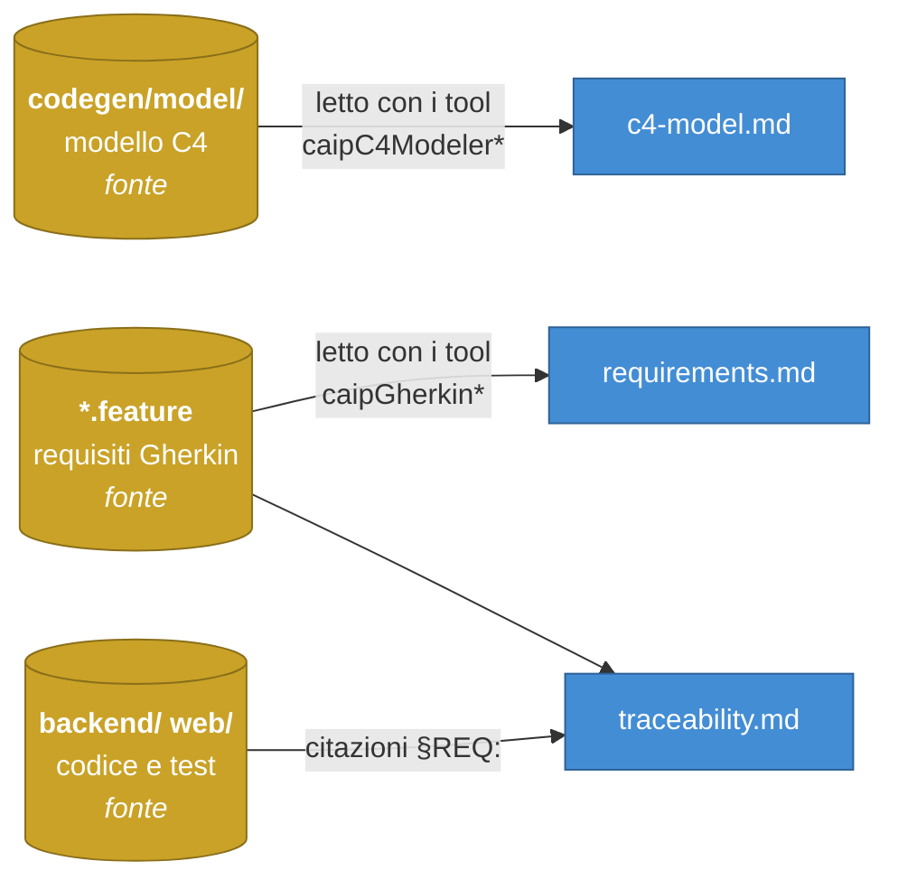

# Documentazione di PierCommander

Tre documenti, tre domande diverse. I diagrammi sono in **Mermaid**: GitHub li
disegna da solo aprendo il file, senza estensioni né toolchain.

| Documento | Risponde a |
|---|---|
| **[`c4-model.md`](c4-model.md)** | *Com'è fatto?* I livelli C4 — contesto, container, la struttura interna del codice, il deployment reale |
| **[`requirements.md`](requirements.md)** | *Cosa deve fare?* I 21 requisiti Gherkin, cosa affermano e perché sono scritti così |
| **[`traceability.md`](traceability.md)** | *Dov'è scritto?* La mappa requisito → codice → test, **generata** dalle citazioni reali |

## Da dove viene questa documentazione

Nessuno dei tre è la fonte di ciò che descrive, ed è bene saperlo prima di
fidarsene:



- **`traceability.md` è generato**: si rigenera, non si corregge.
  ```bash
  python3 scripts/gen_traceability_doc.py
  ```
- **`c4-model.md` e `requirements.md` sono scritti a mano** su dati estratti
  con i tool CAIP. Quando il modello o un requisito cambia in modo
  sostanziale, questi due vanno riletti — un documento che descrive un
  sistema che non esiste più fa danno, non è neutro.

Il modo di verificare che la catena regga è sempre lo stesso, ed è quello che
gira in CI a ogni push:

```bash
python3 scripts/check_traceability.py
```

## E il resto?

Istruzioni di installazione, compilazione, esecuzione, API, Docker, CI/CD e
deployment stanno nel **[README principale](../README.md)**. Qui c'è solo il
*perché* del sistema; là c'è il *come* lo si fa girare.
