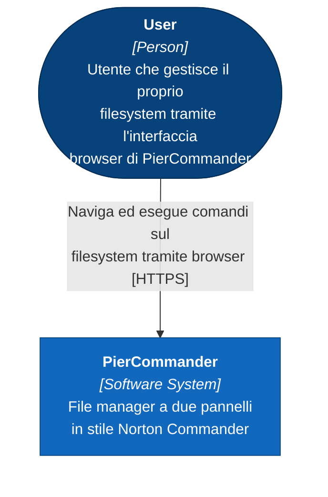
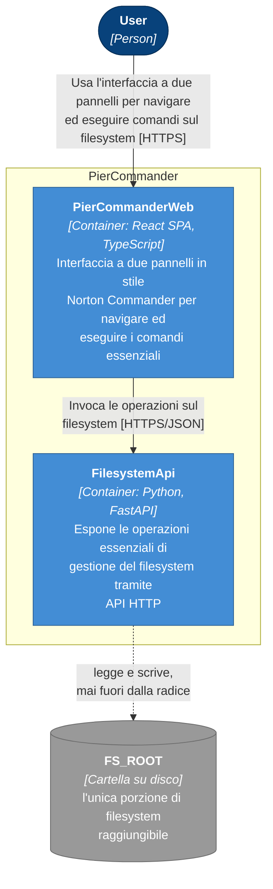
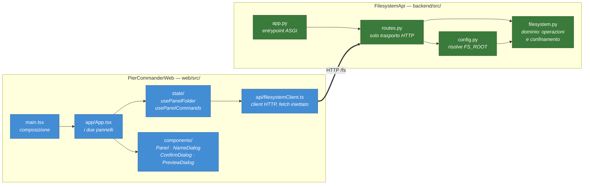
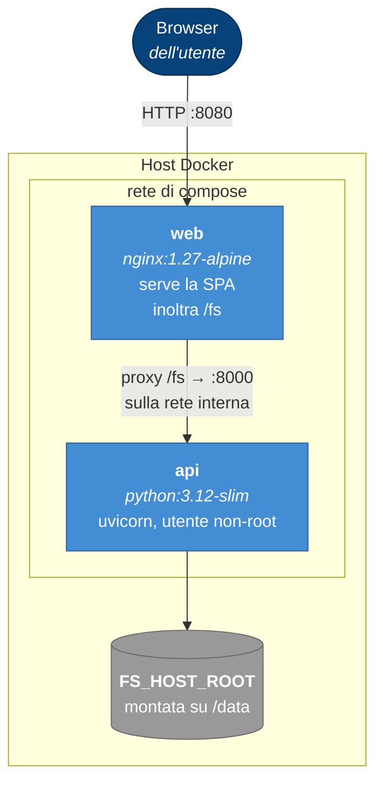

# Il modello C4 di PierCommander

> Questo documento è la **lettura** del modello, non la sua fonte. La fonte è
> il modello CAIP in `codegen/model/`, che si modifica solo con i tool del
> C4 Modeler. Tutto ciò che segue è stato estratto da lì con quei tool: nomi,
> id, descrizioni e relazioni sono quelli del modello, non una parafrasi.
>
> Ultima estrazione: 22 settembre 2026 · `caepVersion: 6` · modalità `universal`
> · validazione del modello: **nessun problema rilevato**.

## Cos'è il C4 in due righe

Quattro livelli di zoom sullo stesso sistema: **Context** (chi lo usa e con
cosa parla), **Container** (le unità eseguibili), **Component** (le parti
dentro un container), **Code** (classi e funzioni). Si scende di livello solo
quando serve — PierCommander si ferma al secondo, e più sotto trovi il perché.

---

## Livello 1 — Context

Chi usa PierCommander, e cosa PierCommander tocca.

| Elemento | Tipo | Ruolo |
|---|---|---|
| **User** | `person` | L'unico attore. Non ci sono ruoli distinti: chi apre PierCommander può fare tutto ciò che il sistema espone |
| **PierCommander** | `software-system` | Il sistema nel suo insieme |

Nessun sistema esterno. È una proprietà notevole e vale la pena dirla: niente
autenticazione delegata, niente storage remoto, niente servizi di terze parti.
L'unica risorsa che PierCommander tocca è **una cartella su disco**, e quella
cartella è configurazione (`FS_ROOT`), non un elemento del modello.

---

## Livello 2 — Container

Le unità eseguibili, e come si parlano.

> `FS_ROOT` è disegnato tratteggiato perché **non è un elemento del modello
> C4**: è la risorsa di configurazione su cui `FilesystemApi` opera. Sta nel
> disegno perché senza di lui la relazione più importante del sistema — il
> confinamento — resterebbe invisibile.

### PierCommanderWeb

| | |
|---|---|
| Tipo | `web-application` · architettura `single-page-application` |
| Target | React · TypeScript |
| Home | `web/` |
| Build · Test · Run | `npm run build` · `npm test` · `npm start` |
| Porta dichiarata | 4200 ⚠️ |

⚠️ Il modello dichiara `port: 4200`, ma `web/vite.config.ts` non fissa la
porta e Vite usa la sua default (5173). Il disallineamento è reale e va
chiuso da una delle due parti — è annotato anche nel README.

### FilesystemApi

| | |
|---|---|
| Tipo | `service` |
| Namespace | `PierCommander.Backend` |
| Target | Python · FastAPI |
| Home | `backend/` |
| Build · Test · Run | `python3 -m compileall -q src` · `python3 -m pytest` · `uvicorn app:api` |

I comandi qui sopra non sono documentazione di cortesia: sono il
`targetProfile` dichiarato nel modello, ed è **quella** la fonte che CI,
container e strumenti leggono. Se cambia il modo di costruire un container,
si aggiorna il `targetProfile` — non solo la pipeline.

### Le due relazioni

| Da | A | Descrizione | Livello |
|---|---|---|---|
| User | PierCommanderWeb | Usa l'interfaccia a due pannelli per navigare ed eseguire comandi sul filesystem [HTTPS] | container |
| PierCommanderWeb | FilesystemApi | Invoca le operazioni sul filesystem [HTTPS/JSON] | container |

Sono **unidirezionali**, e l'assenza è informativa quanto la presenza:
`FilesystemApi` non chiama nessuno. Non c'è push verso il browser, non c'è
callback, non c'è un terzo container che orchestra. Il flusso è sempre lo
stesso: l'utente chiede, il web traduce in HTTP, l'API tocca il disco.

---

## Livello 3 — Component

**Il modello non ha questo livello**, e non è una dimenticanza da colmare:
due container con poche responsabilità ciascuno non guadagnano nulla da un
terzo livello di zoom, e un livello modellato e mai aggiornato è peggio di un
livello assente.

Il codice, però, una struttura interna ce l'ha. Questa è la mappa dei moduli —
**una lettura del codice, non un livello C4**:

Una sola regola di progetto attraversa entrambi: **il confine non sta dove si
riceve la richiesta, ma dove si risolve il percorso**. `routes.py` non
verifica niente, `filesystem.py` risolve ogni percorso e lo confronta con la
radice — così nessuna rotta futura può dimenticare il controllo.

---

## Livello 4 — Code

Non modellato, deliberatamente. A questo livello la fonte è il codice, e il
codice cita i requisiti che soddisfa (`§REQ:<id>`): la navigazione
requisito ↔ implementazione è in [`traceability.md`](traceability.md).

---

## Deployment

Il modello **non contiene ancora un ambiente di deployment** C4. Quello che
esiste è l'artefatto reale di deployment, `deploy/docker-compose.yml`, ed è
questo che descrive:

Il punto che il disegno rende evidente: **l'API non è esposta all'host**. Non
ha un `ports:`, solo un `expose:`. L'unica strada per arrivarci è `/fs`
attraverso nginx — e questo è il motivo per cui il browser vede una sola
origine e non serve alcuna configurazione CORS.

Se e quando il deployment entrerà nel modello, andrà creato con
`caipC4ModelerOpenDeploymentDiagram` e non scritto a mano: le istanze di
container sono *riferimenti* ai container del livello 2, e le relazioni fra
istanze si derivano da sole da quelle del livello 2.

---

## Dove guardare quando il modello cambia

| Domanda | Strumento |
|---|---|
| Cosa c'è a questo livello? | `caipC4ModelerGetActiveLevelDiagram` |
| Cosa dichiara questo nodo? | `caipC4ModelerGetNodesInfo` |
| Chi sta dentro cosa, chi parla con chi | `caipGraphGetGraphContext` |
| Cosa rompo se cambio questo nodo? | `caipGraphGetImpactArea` |
| Il modello è coerente? | `caipC4ModelerGetValidationIssues` |

Il modello si modifica **solo** con questi tool: i file YAML sotto
`codegen/model/` non si editano a mano, e da un `grep` su quei file non si
conclude niente sull'architettura.
