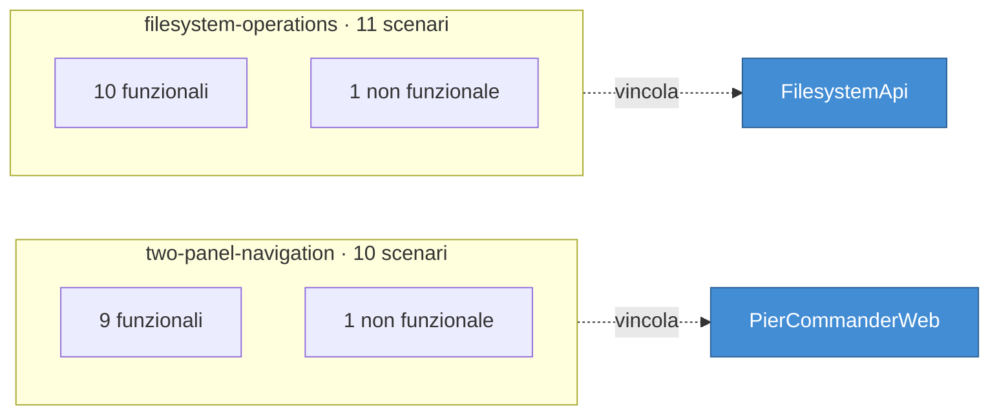
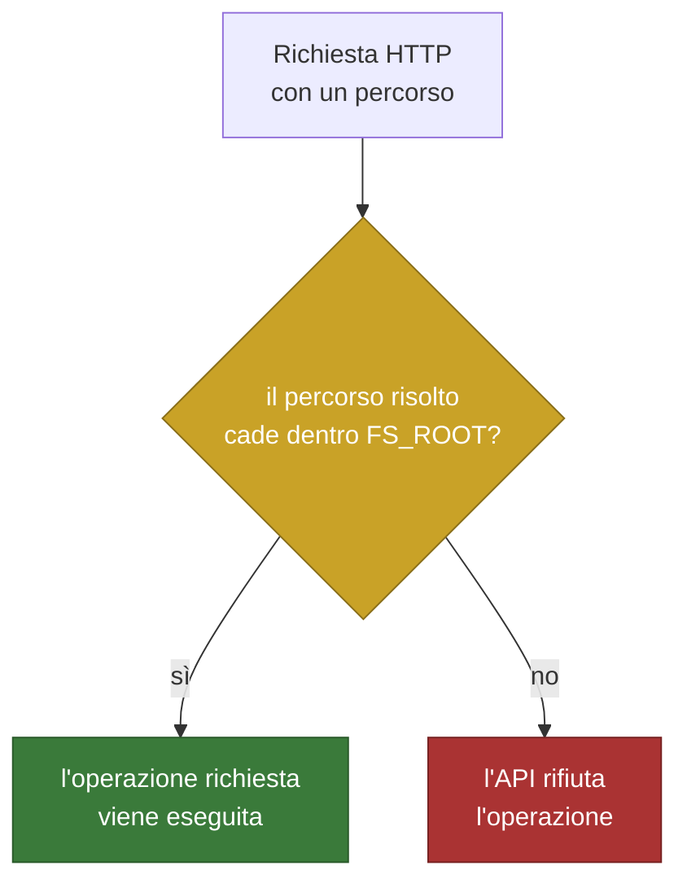
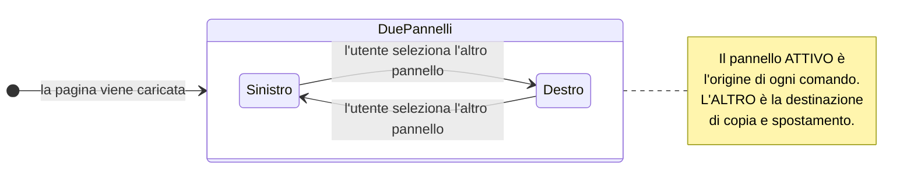
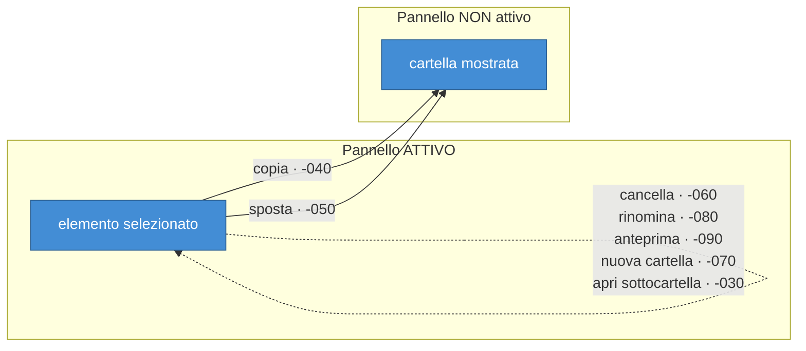
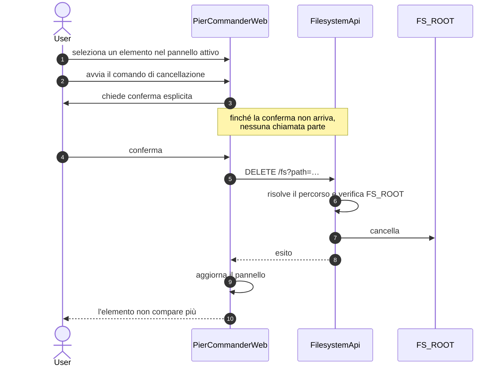

# I requisiti di PierCommander

> Come per il modello C4, questo documento è una **lettura**: la fonte sono i
> due file `.feature` in `codegen/model/requirements/`, letti qui con i tool
> `caipGherkin*`. Gli id, i tag e i passi sono quelli, verbatim.
>
> Ultima estrazione: 22 settembre 2026 · **21 scenari** in 2 documenti.

## Come si legge un requisito qui

Ogni scenario è un comportamento osservabile, scritto in Gherkin e marcato con
tre cose che non sono decorazione:

```gherkin
@id(FLSY-OPRT-SXK-110) @non-functional @c4-container
Scenario: Le operazioni sul filesystem restano confinate alla radice consentita
  Given una radice del filesystem configurata per l'utente
  When l'utente richiede un'operazione su un percorso esterno a quella radice
  Then l'API rifiuta l'operazione
```

| Marcatura | Cosa significa |
|---|---|
| `@id(...)` | la chiave di tracciabilità. Coniata, mai inventata. Il codice e i test la citano come `§REQ:<id>` — è così che si naviga da un requisito alla sua implementazione e ritorno |
| `@functional` / `@non-functional` | se descrive *cosa* fa il sistema o *com'è fatto* (sicurezza, prestazioni, usabilità) |
| `@c4-context`/`@c4-container`/… | a quale livello del modello il requisito vive. Qui sono tutti `@c4-container`: vincolano un'unità eseguibile, non il sistema nel suo insieme |

La forma dell'id non è casuale:

```
FLSY-OPRT-SXK-110
 │    │    │   └── progressivo, a passi di 10, mai riusato
 │    │    └────── token di scope, sorteggiato dal tool che conia
 │    └─────────── lo scenario funzionale: OPeRaTions
 └──────────────── il dominio: FiLeSYstem
```

---

## I due documenti



I due documenti non si sovrappongono: uno descrive **cosa vede e fa
l'utente**, l'altro **cosa garantisce l'API**. Lo stesso gesto — copiare un
file — compare in entrambi, ma da due punti di vista diversi, e per questo ha
due id diversi. Non è duplicazione: il primo è verificato da un test di
componente sul browser, il secondo da un test sull'API.

---

## `filesystem-operations` — Operazioni essenziali sul filesystem

> **Come** utente di PierCommander
> **voglio** poter elencare, navigare, creare, rinominare, copiare, spostare,
> cancellare e visualizzare file e cartelle tramite API
> **così che** posso gestire il mio filesystem da browser come farei con un
> file manager desktop

Le operazioni che l'API garantisce, e l'endpoint che le realizza:

| Id | Scenario | Tipo | Endpoint |
|---|---|---|---|
| `FLSY-OPRT-SXK-010` | Elenco del contenuto di una cartella | funzionale | `GET /fs` |
| `FLSY-OPRT-SXK-020` | Navigazione in una sottocartella | funzionale | `GET /fs` |
| `FLSY-OPRT-SXK-030` | Navigazione alla cartella superiore | funzionale | `GET /fs/parent` |
| `FLSY-OPRT-SXK-040` | Creazione di una nuova cartella | funzionale | `POST /fs/folders` |
| `FLSY-OPRT-SXK-050` | Rifiuto della creazione con nome già esistente | funzionale | `POST /fs/folders` |
| `FLSY-OPRT-SXK-060` | Rinomina di un file o di una cartella | funzionale | `PATCH /fs` |
| `FLSY-OPRT-SXK-070` | Cancellazione di un file o di una cartella | funzionale | `DELETE /fs` |
| `FLSY-OPRT-SXK-080` | Copia in un'altra posizione | funzionale | `POST /fs/copy` |
| `FLSY-OPRT-SXK-090` | Spostamento in un'altra posizione | funzionale | `POST /fs/move` |
| `FLSY-OPRT-SXK-100` | Visualizzazione del contenuto testuale | funzionale | `GET /fs/content` |
| `FLSY-OPRT-SXK-110` | **Confinamento alla radice consentita** | **non funzionale** | *tutti* |

L'ultimo non ha un endpoint proprio perché **attraversa tutti gli altri**: è
la proprietà che ogni operazione deve rispettare.



### Le due navigazioni, e perché sono scenari distinti

`-020` scende, `-030` risale. Sembrano simmetrici e non lo sono: risalire ha
un limite che scendere non ha — la radice consentita. Il `Given` di `-030` lo
dice esplicitamente: *«l'utente si trova in una cartella diversa dalla radice
del filesystem consentito»*.

### La creazione che fallisce è un requisito, non un errore

`-050` è lo scenario negativo di `-040`, e afferma due cose: l'API rifiuta,
**e** il contenuto della cartella resta invariato. La seconda è quella che
conta: un rifiuto che lascia dietro di sé una cartella a metà non soddisfa
questo requisito.

---

## `two-panel-navigation` — Navigazione a due pannelli

> **Come** utente di PierCommander
> **voglio** navigare ed eseguire i comandi essenziali sul filesystem tramite
> un'interfaccia a due pannelli in stile Norton Commander
> **così che** posso orientarmi rapidamente tra due posizioni del filesystem e
> agire su file e cartelle senza lasciare il browser

| Id | Scenario | Tipo |
|---|---|---|
| `TWO-PNL-NVGT-OOX-010` | Visualizzazione del filesystem in due pannelli indipendenti | funzionale |
| `TWO-PNL-NVGT-OOX-020` | Selezione del pannello attivo | funzionale |
| `TWO-PNL-NVGT-OOX-030` | Apertura di una sottocartella dal pannello attivo | funzionale |
| `TWO-PNL-NVGT-OOX-040` | Copia di un elemento verso l'altro pannello | funzionale |
| `TWO-PNL-NVGT-OOX-050` | Spostamento di un elemento verso l'altro pannello | funzionale |
| `TWO-PNL-NVGT-OOX-060` | Cancellazione con richiesta di conferma | funzionale |
| `TWO-PNL-NVGT-OOX-070` | Creazione di una nuova cartella dal pannello attivo | funzionale |
| `TWO-PNL-NVGT-OOX-080` | Rinomina di un elemento selezionato | funzionale |
| `TWO-PNL-NVGT-OOX-090` | Anteprima del contenuto di un file di testo | funzionale |
| `TWO-PNL-NVGT-OOX-100` | **Esecuzione dei comandi essenziali da tastiera** | **non funzionale** |

### Il concetto che tiene insieme tutto: il pannello attivo

Nove scenari su dieci dipendono da `-020`. Non è un dettaglio di interfaccia:
è la regola che dice *dove* un comando agisce, e senza la quale «copia» non
avrebbe una destinazione.



### Dove agisce ciascun comando

Non tutti i comandi coinvolgono entrambi i pannelli, ed è esattamente qui che
si annidano gli equivoci:



Copia e spostamento sono gli **unici** comandi che attraversano i pannelli, e
la destinazione non è una cartella scelta in un dialog: è quella che l'altro
pannello sta già mostrando. È la grammatica di Norton Commander, ed è ciò che
rende il doppio pannello uno strumento invece che due elenchi affiancati.

### Il ciclo di vita di un comando distruttivo

`-060` è l'unico scenario che introduce un passaggio intermedio: la conferma.
Il requisito richiede una conferma **esplicita**, e afferma che senza di essa
non si procede.



Il passo 6 è quel requisito non funzionale dell'altro documento
(`FLSY-OPRT-SXK-110`) che si presenta al lavoro dentro un flusso funzionale.
È così che i due documenti si incontrano: mai citandosi, sempre nello stesso
gesto dell'utente.

### Il requisito da tastiera

`-100` è marcato **non funzionale** perché non aggiunge un comando: chiede che
i comandi che già esistono siano raggiungibili senza mouse. È un vincolo di
usabilità su tutta la superficie dell'interfaccia — e per questo si verifica
scenario per scenario, non con un test solo.

---

## Dal requisito al codice

Ogni id qui sopra è citato nel codice che lo soddisfa e nei test che lo
verificano. La mappa completa, generata dalle citazioni reali e non scritta a
mano, è in **[`traceability.md`](traceability.md)**.

Per rigenerarla dopo una modifica:

```bash
python3 scripts/gen_traceability_doc.py
```

E per verificare che la catena non si sia rotta (è ciò che fa la CI):

```bash
python3 scripts/check_traceability.py
```

---

## Aggiungere o modificare un requisito

I `.feature` **non si editano a mano**: i metadati degli scenari sono lo stato
della pipeline dei requisiti, e si scrivono solo con i tool `caipGherkin*`.

| Serve | Tool |
|---|---|
| un id nuovo | `caipGherkinMintRequirementId` — conia, non inventare |
| aggiungere scenari | `caipGherkinAddScenarios` |
| modificarne uno | `caipGherkinUpdateScenario` |
| i due commenti sopra lo scenario | `caipGherkinSetComments` |
| verificare il documento | `caipGherkinValidate` |

Regola che vale sempre: dopo ogni requisito aggiunto o cambiato si rilegge il
modello e si verifica che gli attori, i container e le relazioni che lo
scenario implica **esistano davvero**. Se manca qualcosa si propone, non si
crea: la struttura è competenza dell'architetto.
