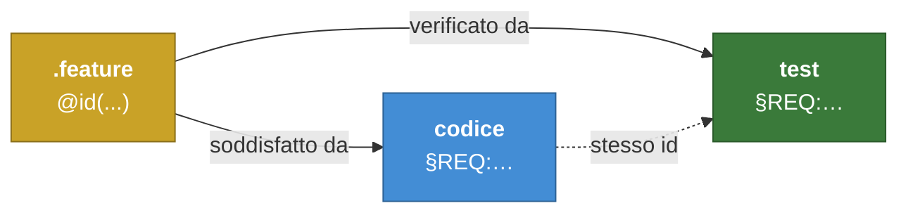

# Tracciabilità: requisito → codice → test

> **Documento generato.** Non modificarlo a mano: rigeneralo con
> `python3 scripts/gen_traceability_doc.py`. Le righe qui sotto sono le
> citazioni `§REQ:<id>` realmente presenti nel codice, non una promessa.
>
> Stato: **21 requisiti su 21** implementati e verificati.

## Come funziona la catena

Ogni artefatto cita **solo il livello immediatamente sopra di sé**: il
codice cita il requisito che soddisfa, il test cita il requisito che
verifica, e il requisito porta i collegamenti al materiale di analisi.
Nessuno salta un anello — un commento nel codice che cita un nodo C4 o un
documento è il sintomo di un collegamento mancante *sul requisito*.

Due controlli la tengono onesta, entrambi in CI:

1. **anti link-rot** — ogni `§REQ:` citato risolve a un `@id(...)` esistente;
2. **copertura** — ogni id è citato da almeno un file di codice *e* almeno un test.

## `filesystem-operations` — Operazioni essenziali sul filesystem

| Requisito | Comportamento | Implementato in | Verificato da |
|---|---|---|---|
| `FLSY-OPRT-SXK-010` | Elenco del contenuto di una cartella | [`backend/src/filesystem.py`](../backend/src/filesystem.py) [`backend/src/routes.py`](../backend/src/routes.py) | [`backend/tests/test_list_folder.py`](../backend/tests/test_list_folder.py) |
| `FLSY-OPRT-SXK-020` | Navigazione in una sottocartella | [`backend/src/filesystem.py`](../backend/src/filesystem.py) [`backend/src/routes.py`](../backend/src/routes.py) | [`backend/tests/test_navigate_subfolder.py`](../backend/tests/test_navigate_subfolder.py) |
| `FLSY-OPRT-SXK-030` | Navigazione alla cartella superiore | [`backend/src/filesystem.py`](../backend/src/filesystem.py) [`backend/src/routes.py`](../backend/src/routes.py) | [`backend/tests/test_navigate_parent.py`](../backend/tests/test_navigate_parent.py) |
| `FLSY-OPRT-SXK-040` | Creazione di una nuova cartella | [`backend/src/filesystem.py`](../backend/src/filesystem.py) [`backend/src/routes.py`](../backend/src/routes.py) | [`backend/tests/test_create_folder.py`](../backend/tests/test_create_folder.py) |
| `FLSY-OPRT-SXK-050` | Rifiuto della creazione di una cartella con nome già esistente | [`backend/src/filesystem.py`](../backend/src/filesystem.py) [`backend/src/routes.py`](../backend/src/routes.py) | [`backend/tests/test_create_folder_conflict.py`](../backend/tests/test_create_folder_conflict.py) |
| `FLSY-OPRT-SXK-060` | Rinomina di un file o di una cartella | [`backend/src/filesystem.py`](../backend/src/filesystem.py) [`backend/src/routes.py`](../backend/src/routes.py) | [`backend/tests/test_rename.py`](../backend/tests/test_rename.py) |
| `FLSY-OPRT-SXK-070` | Cancellazione di un file o di una cartella | [`backend/src/filesystem.py`](../backend/src/filesystem.py) [`backend/src/routes.py`](../backend/src/routes.py) | [`backend/tests/test_delete.py`](../backend/tests/test_delete.py) |
| `FLSY-OPRT-SXK-080` | Copia di un file o di una cartella in un'altra posizione | [`backend/src/filesystem.py`](../backend/src/filesystem.py) [`backend/src/routes.py`](../backend/src/routes.py) | [`backend/tests/test_copy.py`](../backend/tests/test_copy.py) |
| `FLSY-OPRT-SXK-090` | Spostamento di un file o di una cartella in un'altra posizione | [`backend/src/filesystem.py`](../backend/src/filesystem.py) [`backend/src/routes.py`](../backend/src/routes.py) | [`backend/tests/test_move.py`](../backend/tests/test_move.py) |
| `FLSY-OPRT-SXK-100` | Visualizzazione del contenuto testuale di un file | [`backend/src/filesystem.py`](../backend/src/filesystem.py) [`backend/src/routes.py`](../backend/src/routes.py) | [`backend/tests/test_read_content.py`](../backend/tests/test_read_content.py) |
| `FLSY-OPRT-SXK-110` ⚙️ | Le operazioni sul filesystem restano confinate alla radice consentita | [`backend/src/filesystem.py`](../backend/src/filesystem.py) [`backend/src/routes.py`](../backend/src/routes.py) | [`backend/tests/test_root_confinement.py`](../backend/tests/test_root_confinement.py) |

⚙️ = requisito non funzionale.

## `two-panel-navigation` — Navigazione a due pannelli

| Requisito | Comportamento | Implementato in | Verificato da |
|---|---|---|---|
| `TWO-PNL-NVGT-OOX-010` | Visualizzazione del filesystem in due pannelli indipendenti | [`web/src/api/filesystemClient.ts`](../web/src/api/filesystemClient.ts) [`web/src/app/App.tsx`](../web/src/app/App.tsx) [`web/src/components/Panel.tsx`](../web/src/components/Panel.tsx) [`web/src/state/usePanelFolder.ts`](../web/src/state/usePanelFolder.ts) | [`web/src/app/App.two-panels.test.tsx`](../web/src/app/App.two-panels.test.tsx) |
| `TWO-PNL-NVGT-OOX-020` | Selezione del pannello attivo | [`web/src/app/App.tsx`](../web/src/app/App.tsx) [`web/src/components/Panel.tsx`](../web/src/components/Panel.tsx) | [`web/src/app/App.active-panel.test.tsx`](../web/src/app/App.active-panel.test.tsx) |
| `TWO-PNL-NVGT-OOX-030` | Apertura di una sottocartella dal pannello attivo | [`web/src/api/filesystemClient.ts`](../web/src/api/filesystemClient.ts) [`web/src/app/App.tsx`](../web/src/app/App.tsx) [`web/src/components/Panel.tsx`](../web/src/components/Panel.tsx) [`web/src/state/paths.ts`](../web/src/state/paths.ts) | [`web/src/app/App.open-subfolder.test.tsx`](../web/src/app/App.open-subfolder.test.tsx) |
| `TWO-PNL-NVGT-OOX-040` | Copia di un elemento selezionato verso l'altro pannello | [`web/src/api/filesystemClient.ts`](../web/src/api/filesystemClient.ts) [`web/src/app/App.tsx`](../web/src/app/App.tsx) [`web/src/app/app.css`](../web/src/app/app.css) [`web/src/components/Panel.tsx`](../web/src/components/Panel.tsx) [`web/src/state/commandShortcuts.ts`](../web/src/state/commandShortcuts.ts) [`web/src/state/usePanelCommands.ts`](../web/src/state/usePanelCommands.ts) [`web/src/state/usePanelFolder.ts`](../web/src/state/usePanelFolder.ts) | [`web/src/app/App.copy.test.tsx`](../web/src/app/App.copy.test.tsx) |
| `TWO-PNL-NVGT-OOX-050` | Spostamento di un elemento selezionato verso l'altro pannello | [`web/src/api/filesystemClient.ts`](../web/src/api/filesystemClient.ts) [`web/src/app/App.tsx`](../web/src/app/App.tsx) [`web/src/state/commandShortcuts.ts`](../web/src/state/commandShortcuts.ts) [`web/src/state/usePanelCommands.ts`](../web/src/state/usePanelCommands.ts) | [`web/src/app/App.move.test.tsx`](../web/src/app/App.move.test.tsx) |
| `TWO-PNL-NVGT-OOX-060` | Cancellazione di un elemento selezionato con richiesta di conferma | [`web/src/api/filesystemClient.ts`](../web/src/api/filesystemClient.ts) [`web/src/app/App.tsx`](../web/src/app/App.tsx) [`web/src/app/app.css`](../web/src/app/app.css) [`web/src/components/ConfirmDialog.tsx`](../web/src/components/ConfirmDialog.tsx) [`web/src/state/commandShortcuts.ts`](../web/src/state/commandShortcuts.ts) [`web/src/state/usePanelCommands.ts`](../web/src/state/usePanelCommands.ts) | [`web/src/app/App.delete.test.tsx`](../web/src/app/App.delete.test.tsx) |
| `TWO-PNL-NVGT-OOX-070` | Creazione di una nuova cartella dal pannello attivo | [`web/src/api/filesystemClient.ts`](../web/src/api/filesystemClient.ts) [`web/src/app/App.tsx`](../web/src/app/App.tsx) [`web/src/components/NameDialog.tsx`](../web/src/components/NameDialog.tsx) [`web/src/state/commandShortcuts.ts`](../web/src/state/commandShortcuts.ts) [`web/src/state/usePanelCommands.ts`](../web/src/state/usePanelCommands.ts) | [`web/src/app/App.create-folder.test.tsx`](../web/src/app/App.create-folder.test.tsx) |
| `TWO-PNL-NVGT-OOX-080` | Rinomina di un elemento selezionato | [`web/src/api/filesystemClient.ts`](../web/src/api/filesystemClient.ts) [`web/src/app/App.tsx`](../web/src/app/App.tsx) [`web/src/components/NameDialog.tsx`](../web/src/components/NameDialog.tsx) [`web/src/state/commandShortcuts.ts`](../web/src/state/commandShortcuts.ts) [`web/src/state/usePanelCommands.ts`](../web/src/state/usePanelCommands.ts) | [`web/src/app/App.rename.test.tsx`](../web/src/app/App.rename.test.tsx) [`web/src/test/fakeBackend.ts`](../web/src/test/fakeBackend.ts) |
| `TWO-PNL-NVGT-OOX-090` | Anteprima del contenuto di un file di testo selezionato | [`web/src/api/filesystemClient.ts`](../web/src/api/filesystemClient.ts) [`web/src/app/App.tsx`](../web/src/app/App.tsx) [`web/src/app/app.css`](../web/src/app/app.css) [`web/src/components/PreviewDialog.tsx`](../web/src/components/PreviewDialog.tsx) [`web/src/state/commandShortcuts.ts`](../web/src/state/commandShortcuts.ts) [`web/src/state/usePanelCommands.ts`](../web/src/state/usePanelCommands.ts) | [`web/src/app/App.view-file.test.tsx`](../web/src/app/App.view-file.test.tsx) [`web/src/test/fakeBackend.ts`](../web/src/test/fakeBackend.ts) |
| `TWO-PNL-NVGT-OOX-100` ⚙️ | Esecuzione dei comandi essenziali da tastiera | [`web/src/app/App.tsx`](../web/src/app/App.tsx) [`web/src/app/app.css`](../web/src/app/app.css) [`web/src/components/FunctionKeyBar.tsx`](../web/src/components/FunctionKeyBar.tsx) [`web/src/state/commandShortcuts.ts`](../web/src/state/commandShortcuts.ts) | [`web/src/app/App.keyboard.test.tsx`](../web/src/app/App.keyboard.test.tsx) |

⚙️ = requisito non funzionale.

## Dove pesano i requisiti

I file che soddisfano più requisiti sono quelli da leggere per primi, e
quelli da toccare con più attenzione:

| File | Requisiti soddisfatti |
|---|---|
| [`backend/src/filesystem.py`](../backend/src/filesystem.py) | 11 |
| [`backend/src/routes.py`](../backend/src/routes.py) | 11 |
| [`web/src/app/App.tsx`](../web/src/app/App.tsx) | 10 |
| [`web/src/api/filesystemClient.ts`](../web/src/api/filesystemClient.ts) | 8 |
| [`web/src/state/commandShortcuts.ts`](../web/src/state/commandShortcuts.ts) | 7 |
| [`web/src/state/usePanelCommands.ts`](../web/src/state/usePanelCommands.ts) | 6 |
| [`web/src/app/app.css`](../web/src/app/app.css) | 4 |
| [`web/src/components/Panel.tsx`](../web/src/components/Panel.tsx) | 4 |
| [`web/src/components/NameDialog.tsx`](../web/src/components/NameDialog.tsx) | 2 |
| [`web/src/state/usePanelFolder.ts`](../web/src/state/usePanelFolder.ts) | 2 |

